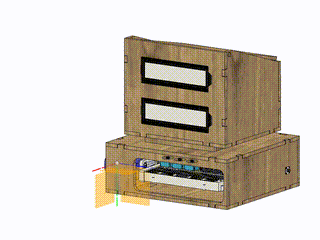
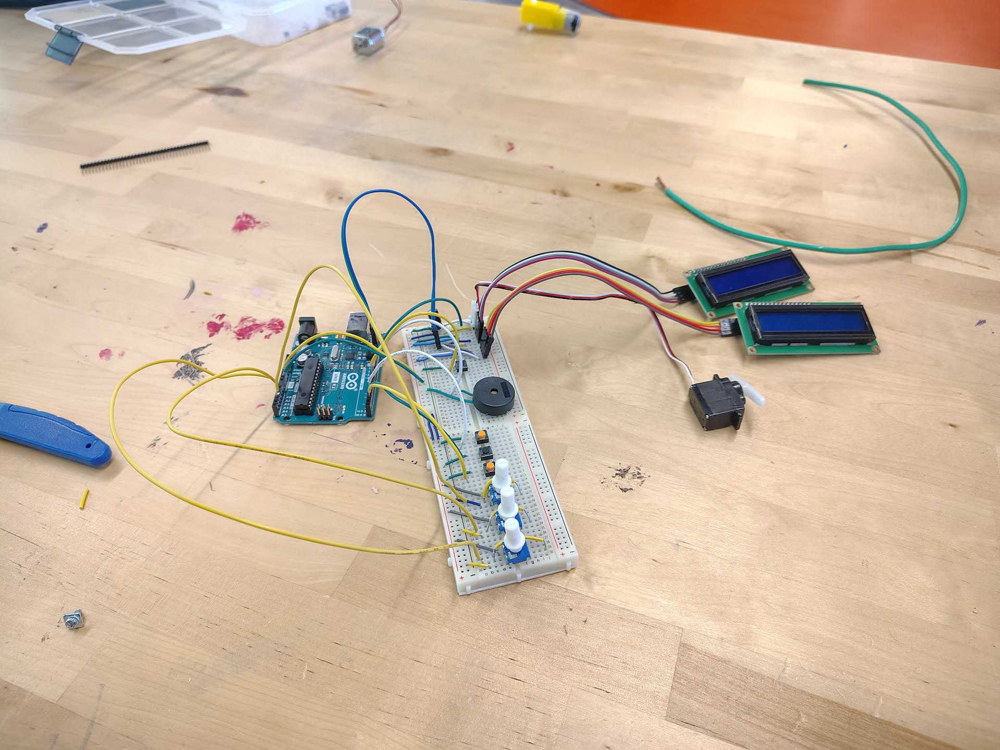

# How to build this project:
> You can skip 90% of this guide by just studying the exploded view GIF, Tinkercad Ciruit, and/or the latest version of the fusion model located in the "Fusion Model" folder
>> The other 10% are in the "Absurd solution" section below
>> Also note that you need to change the memory address of the 

- Exploded View
    

    
    

- Other views that may be of use
    -  Front view
    

    
    

    - Side view
    

    
    

    - Top interior view
    

    
    

    - General interior view
    

    
    

### Connecting the circuits
    - As long as everything gets connected right, it really doesn't matter how it all interconnects
    - The tinkercad simulation displays it all connected via 3 breadboards, I suggest for the sake of space, follow the second image where the breadboards for the LCD and general components are combined into 2 breadboards
        - Basically, the keyboard is one one breadboard, and everything is on the other

- (first image) Tinkercad simulation

    

- (second image) IRL circuit

    

-  Leave the project like this when you're just about ready to attach the servo motor horn mechanism (the one that activates/ejects the keyboard)
    

    
    

# Absurd solution:
> This section defines how I made the locking mechanism
> It is in my opinion the easiest way of implementing the keyboard locking mechanism as 3D printing Servo Horns with a 0.4mm nozzle apparently does not compare to a regular servo horn drilled (trust me I tried)
>> You will NOT need the servo motor horn clasp thing anymore...

- Servo motor horn clasp thing
//here

- Start by drilling the servo horn...
    - Basically, take a generic servo horn you get from an arduino kit and drill the 2nd hole after the big hole
- The measurements of the holes are as follows (if someone wants to model this):
    - Servo motor horn measurement general width
        

        
        

    - Servo motor horn measurement hole width
        

        
        

    - Servo motor horn measurement hole placement distance
        

        
        

### Positioning notes
- First connect the mechanism to the breadboard

- Load the program into the arduino and press the side button to turn the system "on" it should be 
- The mechanism should be placed parallel to the surface when it is extended in the keyboard's activated position

- Servo motor horn position (dormant)
    

    
    

- Servo motor horn position (ejected/activated)
    

    
    

- Trust this activated servo motor horn position more than the firat image...
    

    
    

- Breadboard latch module (basically the main mechanism)
    

    
    
