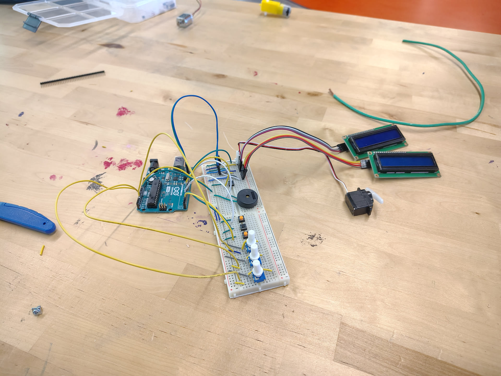
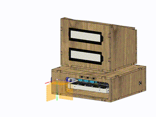

# Base-62-Project
An Arduino calculator/converter for arbitrary bases from 1-62 using an oversimplified keyboard and 2 kb of RAM :<

# Why did I make this:
Always wanted to make some sort of computer with the arduino and found that no one has tried to optimize the universal base converter into an incredibly weak system, much less even make a clauclator out of it...

# Did I regret this (somehow no):
- Made me grateful of modern computer memory capacity **:l**
    - Bro this micro-controller has less RAM then modern-calculators for this function
- Used more geometry in this roject than at any other point in my life...
- Added onto my collection of absurd project ideas
- Needed to find reasons to use my school's workshop before I graduated...

# How to read the manual/operate:
```
    - Module Format: [Applicable region] [function/values] [interaction type]
    - Parenthesis: [default value] <clarification> {max digit length allowed} (notes)
    - % = scroll-able position
    - # = value placeholder
```

## Main OS:
```
    - Start screen (press the on button to return to this screen)
        - At boot:
        - Update and check all potentiometer states
        - Reset all variables to default

    - Main screen:
        - % Base <setting screen> (sets the bases)
        - % Operation <setting screen> (sets the operation in calc. mode)
        - % Conversion <screen> (only converts)
        - % Calculation <screen> (Calculates and converts)

    - Base setting screen:
        - % Base From: # [10] {2} (sets to potentiometer degree)
        - % Base To: # [10] {2}
        - % back

    - Operation setting screen
        - % Operation: # [+] {1}
        - % back

    - Conversion screen
        -   "From" Value:
        - % # [0] {14}

    - Conversion execute screen:
        -   Result:
        -   # [0] {16}
        -   # [0] {16}
        - % back

    - Calculation screen
        -   Value 1:
        - % # [0] {14}
        -   Value 2:
        - % # [0] {14}

    - calculation execute screen:
        -   Result:
        -   # [0] {16} (part 1 of result)
        -   # [0] {16} (part 2 of result)
        - % back

    main modules:
        - potent1 => inputs 0-9 scrolling / navigation scrolling
        - potent2 => inputs A-Z scrolling / bases 0-31 scrolling / operations +-* / scrolling
        - potent3 => inputs a-z scrolling / bases 32-62 scrolling
        - button1 => calc. & convert enter button
        - button2 => calc. & convert backspace button
        - button3 => navigation selection button / calc. & convert next button
```

# Notes:
- You can always reset the system using the side power button
- The keyboard launches out when the "power" is on
- the model is parametric, you can edit it on Fusion...
    - Default wall-width : 0.125 in
    - Default wood-fitting tolerance : 0.02 in
- Scroll down for construction instructions
- Like all calculators, there is a limit to how big of a number it can process (long int)

# Pictures!

### Tinkercad:
<p align="left">
    
</p>
> <a href="https://www.tinkercad.com/things/6n480BIajVO-base-62-project" target="_blank">here</a>

### Final CAD model
<p align="left">
    
</p>
> Mind the origin still appearing (I forgot to turn it off on the screw component and rendering is killing my computer)

<p align="left">
    
</p>

### IRL build
-  Circuit
    - <p align="left">
        
        </p>
        
-  Top "screen" portion
    - <p align="left">
        
        </p>

- Bottom "Keyboard" portion
    - <p align="left">
        
        </p>

-  Full Build
    - <p align="left">
        
        </p>


### Exploded view
<p align="left">
    
</p>

### Notes Pt.2:
> I suggest looking at the 3D model to look at the placement of parts
> you will most likely need to wood-glue the frame together (just don't wood glue the lid of the keyboardEnclosure module)
- You can glue everything attached to it, just it's recommended not to glue the lid (or your arduino will never come out...)
- <p align="left">
    
    </p>

# Parts list:
- I2C LCDs (x2)
- Half-sized Breadboards (x2)
- Arduino UNO R3 [preferably R4] (x1)
- CA9 Potentiometers [the Arduino type] (x3)
- Standard push buttons (x4)
- Generic 180 degree Servo motor (x1)
- A piezo (x1)
- A whole lot of Male-Male and Male-Female Jumper wires
    - <a href="https://www.amazon.com/Elegoo-EL-CP-004-Multicolored-Breadboard-arduino/dp/B01EV70C78/" target="_blank">Something like this</a>
    - The link is NOT AFFILIATED ```-_-```
- <a href="https://github.com/Hashikono/Base-62-Project/tree/main/Fusion%20Model/3D%20prints%20-%20STL" target="_blank">3D printed parts</a>
- <a href="https://github.com/Hashikono/Base-62-Project/tree/main/Fusion%20Model/Frames%20-%20DXF%20files" target="_blank">Laser cut frame</a>

# Model credits:
> Thank you to these wonderful people for open-sourcing standardized part models, some of which were annoyingly difficult to find...
- <a href="https://grabcad.com/library/arduino-uno-r3-19" target="_blank">Arduino UNO R3</a>
- <a href="https://grabcad.com/library/half-size-breadboard-1" target="_blank">Half-sized Breadboard</a>
- <a href="https://grabcad.com/library/1602a-i2c-lcd-display-module-for-arduino-1" target="_blank">1602A I2C LCD</a>
- <a href="https://grabcad.com/library/ardunio-potentiometer-ca9-cermet-acp-1" target="_blank">CA9 Potentiometer</a>
- <a href="https://grabcad.com/library/push-button-64" target="_blank">Standard Push Button</a>
- <a href="https://grabcad.com/library/micro-servo-9g-7" target="_blank">Micro Servo Motor 9g</a>
- <a href="https://grabcad.com/library/pt-1540p-piezo-buzzer-1" target="_blank">PT-1540P Piezo Buzzer</a>
